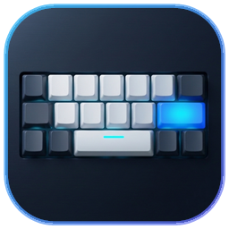

<p align="center">
  
</p>

# Virtual Keyboard

An always-on-top on-screen keyboard for Windows that types into **whatever app currently has focus** — browsers, Notepad, Word, chat apps — without ever taking focus away from it.

Portable: one `.exe`, no installer, no .NET runtime required.

---

## Features

- **Types into the focused app** using `SendInput` (Unicode characters + virtual-key shortcuts).
- **Never steals focus**: the keyboard window is `WS_EX_NOACTIVATE` / `MA_NOACTIVATE` and all keys are non-focusable, so the caret stays where it was.
- **US QWERTY and Arabic** layouts; Arabic is a true mirrored RTL layout with Arabic-Indic digits (٠١٢٣…) and shift variants.
- **Sticky modifiers**: tap Shift / Ctrl / Alt / Win once for one-shot, double-tap to lock. Caps toggles Shift lock.
- **Word suggestions** above the keys, fully offline: bundled English + Arabic lists plus words you type. Tapping a suggestion replaces the in-progress word.
- **Comfort keys**: auto-repeat (Backspace, arrows, Space), long-press accents (`e` → `é è ê ë`, `ا` → `أ إ آ ٱ`), click sound, press animation.
- **Window**: bottom-docked by default, draggable by the header, width-resizable, remembers position and size.
- **Collapses to the taskbar**: the header `—`, the tray toggle or `Ctrl+Alt+K` minimize it to a taskbar button with the app icon — nothing vanishes, click the button to bring it back.
- **Auto-show**: while collapsed, it pops back up the moment you focus a text field in another app (browser search bar, Notepad, terminal…). Disable it in Settings if you prefer to control it manually.
- **Tray icon** with layout/theme/settings/autostart menu, and a global **Ctrl + Alt + K** show/hide hotkey.
- **Themes**: Dark, Light, High Contrast, **Doctor Doom** (Marvel), **Spider-Man** (Marvel), **Black Panther (Vibranium)** (Marvel), **Neon Cyberpunk**, and **Sakura Blossom** — with a quick header theme picker (`🎨`), live preview in Settings, and tray menu selection.
- **Optional start with Windows** (`HKCU\…\Run`).

## Quick start

1. Copy `VirtualKeyboard.exe` anywhere (e.g. `C:\Tools\VirtualKeyboard\`).
2. Run it. The keyboard appears at the bottom of the screen and a tray icon appears.
3. Click into any app, then click keys.

No administrator rights are needed.

## Using it

| Action | Result |
|---|---|
| Click a letter | Types it into the focused app |
| Tap `Shift`, then a key | One shifted character; Shift clears itself |
| Double-tap `Shift` | Locks Shift until tapped again (also `Caps`) |
| Tap `Ctrl`, then `a` | Sends `Ctrl+A` to the focused app |
| Hold a letter with accents | Shows an alternate strip; tap one to insert it |
| Hold Backspace / arrow / Space | Repeats |
| `Clear All` | Selects everything in the focused field and deletes it (`Ctrl+A`, `Backspace`) |
| Tap a suggestion | Replaces the current word |
| `ع` / `EN` key (or header button) | Switches layout |
| Header `⚙` | Settings |
| Header `—` | Minimizes to the taskbar (the app icon stays there) |
| Header `✕` | Closes (exits) Virtual Keyboard |
| Click the keyboard's taskbar icon | Restores it |
| Focus a text field while hidden | Keyboard comes back automatically (see Settings) |
| `Ctrl + Alt + K` | Show/hide from anywhere |
| Tray icon | Show/hide, layout, theme, autostart, settings, exit |

## Files beside the exe

The app is portable and keeps everything next to the executable:

| File | Purpose |
|---|---|
| `settings.json` | Theme, layout, key height, suggestions, position, auto-show, autostart |
| `learned-words.json` | Words you type, used to rank suggestions |
| `wordlists\*.txt` | Optional custom words, one per line (UTF-8). Any language. |
| `error.log` | Only created if an unexpected error occurs |

Deleting `settings.json` resets everything to defaults.

### Auto-show while hidden

The keyboard watches focus via UI Automation. When it is minimized and you click into a text field in another app, it restores itself without taking focus away from that field. If you collapse while already inside a field, it stays put until you focus a *different* field — so the collapse button never feels like it did nothing.

Uncheck **Show automatically when a text field is focused** in Settings to keep it hidden until you click its taskbar icon or press `Ctrl+Alt+K`.

### Adding your own words

Create `wordlists\my-words.txt` next to the exe with one word per line:

```
kubernetes
typescript
مرحبا
```

Restart the app; your words are merged into the predictor.

## Building from source

Requirements: Windows 10/11 x64 and the **.NET 8 SDK**.

```powershell
dotnet build VirtualKeyboard.sln
dotnet test tests\VirtualKeyboard.Core.Tests\VirtualKeyboard.Core.Tests.csproj
dotnet run --project src\VirtualKeyboard.App
```

### Publishing the portable exe

```powershell
.\publish.ps1
```

Produces `publish\VirtualKeyboard.exe` — self-contained, single file, compressed, win-x64. Copy that one file to any Windows machine.

## Project layout

```
.github/workflows/ci.yml   Windows CI (build + xUnit tests)
docs/PLAN.md               Architecture, technical decisions, and milestones
docs/icon.png              App icon preview
src/VirtualKeyboard.Core   Pure logic: layouts, sticky state, injection planning,
                           prediction, themes, settings. Unit-tested, no UI.
src/VirtualKeyboard.App    WPF shell: window, keys, 8 themes, tray, hotkey, settings UI.
tests/…Core.Tests          xUnit tests (47).
tools/make-icon.ps1        Generates the multi-size .ico and docs/icon.png.
publish.ps1                Builds the self-contained single-file executable.
```

## Limitations

- **Elevated windows are out of scope.** Windows blocks synthetic input from a normal process to higher-integrity windows (Task Manager, UAC prompts, admin consoles). Run the keyboard as administrator if you need those — at your own risk.
- **Anti-cheat games are out of scope.** They typically ignore `SendInput` and require a kernel driver.
- The physical keyboard is independent: this app does not mirror or intercept it.
- Auto-show uses UI Automation, so a few custom-drawn or protected controls may not be detected as text fields; in that case restore the keyboard manually (taskbar icon or `Ctrl+Alt+K`).
- Bundled wordlists are compact starters, not a full corpus; add your own via `wordlists\`.
- Windows 10/11 x64 only.

## Privacy

Everything is offline. No network access, no telemetry, no accounts. The only data stored is `settings.json` and `learned-words.json` beside the exe.
